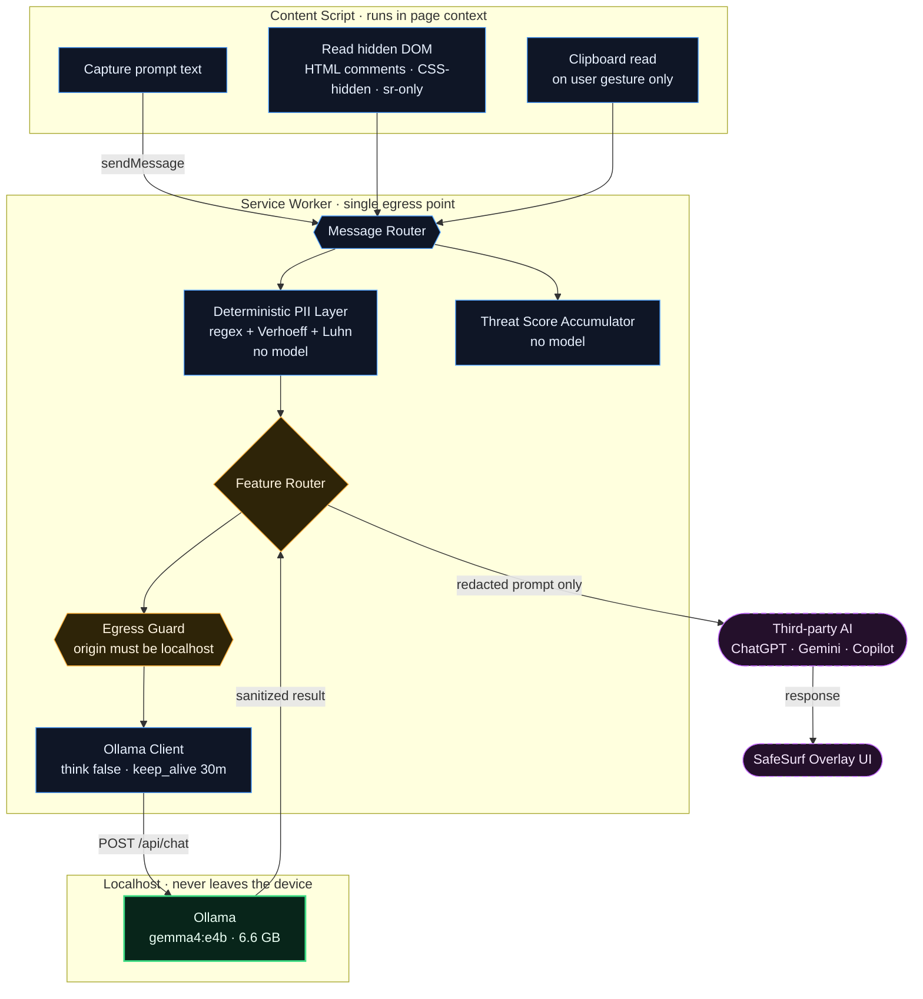
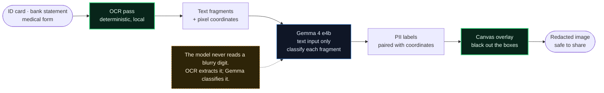

# SafeSurf — Implementation Plan

**Vision:** You get the AI's help. The AI never gets your secrets.

Local-first privacy browser extension. Gemma 4 (`gemma4:e4b`) running on-device via
Ollama. Nothing leaves the user's machine.

---

## 1. Model Decision (settled)

| | |
|---|---|
| **Model** | `gemma4:e4b` (Gemma 4, edge tier) |
| **Size on disk** | 6.6 GB (Q4_K_M) |
| **Context** | 128K |
| **Modalities in** | Text, Image, Audio |
| **Vision encoder** | ~150M (vs ~550M on workstation sizes) |
| **License** | Apache 2.0 |
| **Hosting** | Ollama, `http://localhost:11434` |

### Download

```bash
ollama pull gemma4:e4b
```

Verify:

```bash
ollama list | grep gemma4
curl http://localhost:11434/api/tags
```

> Apple Silicon note: Ollama ≥ 0.40 runs supported architectures on MLX by default.
> Your client is 0.35.1 — update before benchmarking, or results won't be comparable
> to teammates. An explicit `gemma4:e4b-mlx` tag also exists (9.5 GB) if you want to
> pin it, but the plain tag is what teammates should use.

**Do not run bare `ollama run gemma4`** — that resolves to `latest`, which happens to
be e4b today but is not a promise. Pin `gemma4:e4b` everywhere.

### Why e4b is sufficient

It fulfils 4 of 5 features outright, and the 5th is blocked by a property of the
text-output interface, not model size (see §5.5). It is also the *only* choice that
satisfies the "nothing leaves the device" claim — the Gemini API route breaks it.

---

## 2. Environment Setup (Phase 0)

A browser extension is an opaque origin. Ollama will refuse it until you say otherwise.

```bash
launchctl setenv OLLAMA_ORIGINS "chrome-extension://*,moz-extension://*,safari-web-extension://*"
launchctl setenv OLLAMA_CONTEXT_LENGTH 16384
launchctl setenv OLLAMA_NO_CLOUD 1
launchctl setenv OLLAMA_MAX_LOADED_MODELS 1
launchctl setenv OLLAMA_NUM_PARALLEL 1
launchctl setenv OLLAMA_KEEP_ALIVE 30m

mkdir -p ~/.ollama
echo '{"disable_ollama_cloud": true}' > ~/.ollama/server.json
```

Quit and reopen the Ollama app. Then confirm it actually loaded on GPU:

```bash
ollama ps        # PROCESSOR column should read 100% GPU, not a CPU/GPU split
```

| Variable | Why |
|---|---|
| `OLLAMA_ORIGINS` | **Required.** Without it every fetch from the extension 403s. |
| `OLLAMA_CONTEXT_LENGTH` | Default is 4096 — too small for page-level scans. |
| `OLLAMA_NO_CLOUD` | Blocks accidental fallback to a `:cloud` variant. Enforces the thesis. |
| `OLLAMA_MAX_LOADED_MODELS 1` | Single model → deterministic memory, no swap thrash. |
| `OLLAMA_NUM_PARALLEL 1` | Parallel requests multiply context memory. |
| `OLLAMA_KEEP_ALIVE` | Avoids a multi-second model load on first use. |

---

## 3. Architecture



**Rule:** all model calls originate in the service worker. Content scripts never call
Ollama directly. This keeps `host_permissions` narrow to one origin and gives you a
single place to enforce "no network egress" as a code invariant.

---

## 4. Project Structure

```
safesurf/
├─ manifest.json
├─ config.js                 # model name, thresholds — only place a model id appears
├─ background/
│  ├─ service-worker.js
│  ├─ ollama-client.js       # fetch wrapper, retries, timeouts
│  └─ egress-guard.js        # asserts destination === localhost:11434
├─ lib/
│  ├─ pii-deterministic.js   # regex + checksum, NO model
│  ├─ rephrase.js
│  ├─ injection-scan.js
│  ├─ vision-redact.js
│  ├─ threat-score.js
│  └─ clipboard-guard.js
├─ content/
│  ├─ content.js
│  └─ overlay.css
├─ tests/
│  ├─ golden/cases.json
│  ├─ golden/run.js
│  └─ unit/
└─ docs/
   └─ BENCHMARKS.md
```

---

## 5. Modules

### 5.1 Ollama client (`background/ollama-client.js`)

Single wrapper. Every feature module goes through it.

```js
// config.js
export const OLLAMA = 'http://localhost:11434';
export const MODEL   = 'gemma4:e4b';

export const THINKING = false;      // never pay for reasoning tokens you discard
export const KEEP_ALIVE = '30m';
```

```js
// background/ollama-client.js
export async function chat({ system, user, images = [], schema = null, ctx = 4096 }) {
  const res = await fetch(`${OLLAMA}/api/chat`, {
    method: 'POST',
    headers: { 'Content-Type': 'application/json' },
    body: JSON.stringify({
      model: MODEL,
      stream: false,
      think: THINKING,
      keep_alive: KEEP_ALIVE,
      messages: [
        ...(system ? [{ role: 'system', content: system }] : []),
        { role: 'user', content: user, ...(images.length && { images }) },
      ],
      ...(schema && { format: schema }),
      options: { temperature: 0.1, num_ctx: ctx },   // determinism, not the documented 1.0
    }),
  });
  if (!res.ok) throw new Error(`ollama ${res.status}`);
  return JSON.parse((await res.json()).message.content);
}
```

> `temperature: 0.1` deliberately overrides Gemma's documented `1.0`. You want a
> security tool to give the same answer twice.

**Preload** at service-worker startup with an empty request so the first user action
isn't a model load:

```js
fetch(`${OLLAMA}/api/chat`, { method:'POST', body: JSON.stringify({ model: MODEL, keep_alive: KEEP_ALIVE }) });
```

**Timeout:** 30 s hard cap. Abort and pass through unredacted-with-warning on timeout —
never silently fail open.

### 5.2 Deterministic PII layer (`lib/pii-deterministic.js`) — build this first

Highest value per hour, zero model dependency, and it makes e4b's compliance weakness
unreachable. Formats are unambiguous; never route them through a model.

| Detector | Rule |
|---|---|
| Aadhaar | 12 digits + **Verhoeff** checksum |
| PAN | `[A-Z]{5}[0-9]{4}[A-Z]` |
| Card | Luhn checksum |
| Email / phone (IN) | regex |
| IBAN | mod-97 |
| Secrets | AWS key prefix, `ghp_`, JWT (`eyJ…`), PEM blocks |
| High-entropy token | Shannon entropy > 4.0 over any run ≥ 16 chars |

Runs **before** the model, on every prompt, every time. The model never sees a
formatted identifier — only free-text PII (names, addresses, diagnoses, employer).

```js
export function scanDeterministic(text) {
  // returns [{ category, original, replacement, span }]
  // replacement e.g. "[AADHAAR_1]" — stable, reversible on-device
}
```

Checksum validation matters: `[A-Z]{5}[0-9]{4}[A-Z]` alone produces false positives on
ordinary text; the Verhoeff/Luhn gates are what make it usable.

### 5.3 Rephrasing (`lib/rephrase.js`)

The one place quality is user-visible. Structured output, thinking off, low temp.

```js
const SCHEMA = {
  type: 'object',
  properties: {
    rewritten: { type: 'string' },
    found: {
      type: 'array',
      items: {
        type: 'object',
        properties: {
          category: { type: 'string',
            enum: ['aadhaar','pan','credentials','financial','health','contact','pii','none'] },
          original: { type: 'string' },
          replacement: { type: 'string' },
        },
        required: ['category','original','replacement'],
      },
    },
    intent_preserved: { type: 'boolean' },
  },
  required: ['rewritten','found','intent_preserved'],
};
```

Because `original` comes back, you can hold a **reversible** mapping locally: the remote
AI only ever sees `rewritten`, the user's own device retains the plaintext. This is the
strongest argument in the writeup — feature it explicitly.

**Guard:** if `intent_preserved === false`, fall back to a template rewrite rather than
sending a degraded prompt. A lost intent is worse than a leak the user chose.

### 5.4 Injection scanner (`lib/injection-scan.js`)

Two inputs: page text (visible **and** hidden) and submitted prompt.

Hidden content to collect before sending:

```js
const hidden = document.querySelectorAll(
  '[style*="display:none"],[style*="visibility:hidden"],.sr-only,[hidden],template'
);
// plus HTML comment nodes, plus the full innerText of the whole document
```

Classification via `chat()` with `ctx: 16384`. Ask for a verdict + the exact
instruction found, so you can show the user *what* the page was trying to do.

This is the feature where 128K context vs 256K would matter — but a typical page is
10–50K tokens, so e4b is fine.

### 5.5 Vision redaction (`lib/vision-redact.js`) — the risky module

**Constraint:** Gemma 4 emits text, not bounding boxes. No size (e4b, 26B, 31B) can
black out pixels through Ollama. This is an interface limit, not a model-size limit.
Plan accordingly from day one rather than discovering it in Phase 5.

Architecture that works:



The model never reads a blurry digit — OCR does that deterministically, Gemma only
classifies extracted text. This converts the hardest vision task into an easy one and
**eliminates e4b's vision-encoder disadvantage** (150M vs 550M) from the critical path.

Residual vision-only cases (face photo, signature, QR containing an ID) still go to
e4b as an image. Use the **highest visual token budget (1120)** for these — Gemma 4
exposes budgets of 70/140/280/560/1120, and 1120 is the OCR/read-small-text setting.

> ⚠️ Verify the exact Ollama parameter name for the visual token budget before relying
> on it — it's documented in the Gemma 4 model card but the Ollama field name isn't
> confirmed here. Fall back to the model default if you can't find it; classification
> degrades gracefully.

**Phase 5 is the schedule risk.** If OCR integration threatens the demo, ship text
redaction + an "image contains possible PII" warning, and keep the full pipeline for
afterwards. A working rephrase + injection demo beats an unfinished redactor.

### 5.6 Threat score (`lib/threat-score.js`)

Mostly arithmetic — the model contributes a small semantic component at most.

Signals: repeat-visit rate to high-sensitivity domains, dwell time on
finance/health/gov pages, cross-site sensitivity hopping, prompts containing
credential-shaped strings.

```
score = Σ(wᵢ · normalize(sᵢ))   →  0…100
```

Show the user the **breakdown**, not just the number. An opaque score is unactionable.

### 5.7 Clipboard guard (`lib/clipboard-guard.js`)

Read only on genuine user gesture, only if the extension is enabled. Entropy +
pattern match for passwords, tokens, card numbers, keys. Warn, never block.

---

## 6. manifest.json (MV3)

```json
{
  "manifest_version": 3,
  "name": "SafeSurf",
  "version": "0.1.0",
  "permissions": ["storage", "activeTab", "scripting", "clipboardRead"],
  "host_permissions": ["http://localhost:11434/*"],
  "background": { "service_worker": "background/service-worker.js", "type": "module" },
  "content_scripts": [{ "matches": ["<all_urls>"], "js": ["content/content.js"], "run_at": "document_idle" }],
  "action": { "default_title": "SafeSurf" }
}
```

Note `<all_urls>` in `content_scripts` is broad — justify it in the store listing, and
keep actual network privilege to the single Ollama origin.

---

## 7. Egress guard (`background/egress-guard.js`)

Make the thesis *testable*, not just claimed.

```js
export function assertLocal(url) {
  const u = new URL(url);
  if (u.origin !== 'http://localhost:11434') {
    throw new Error(`SafeSurf: blocked non-local request to ${u.origin}`);
  }
  return url;
}
```

Wrap every `fetch` in the service worker through this. Then add a test that greps the
bundled source for `http(s)://` literals outside localhost. That's a verifiable claim
in your writeup.

---

## 8. Testing

### Golden set (`tests/golden/cases.json`)

25 cases up front — fake Aadhaar/PAN/card/credential formats, expected categories,
acceptable-rephrase list.

**Build this in Phase 2, not at the end.** It's what makes the e4b decision measurable
instead of assumed, and it's your best evidence in the writeup:

> Deterministic layer: 23/25. e4b caught the remaining semantic cases. PII leak rate
> across the corpus: 8% before SafeSurf, 0% after.

```bash
node tests/golden/run.js
```

### Required coverage

- Every deterministic detector has ≥1 positive and ≥1 near-miss negative (checksum
  gates are where false positives hide)
- Rephrase: assert intent preserved, not just that output differs
- Injection: obfuscated payloads (base64, leetspeak, HTML entities) in hidden nodes
- `intent_preserved: false` path actually falls back
- Ollama timeout → fail-loud, not fail-open
- Egress guard rejects a non-localhost URL

---

## 9. Schedule

| Phase | Work | Est. |
|---|---|---|
| 0 | Env setup, pull e4b, verify GPU, `/api/tags` | 0.5 d |
| 1 | Manifest + service worker + ollama-client + egress guard | 1 d |
| 2 | Deterministic PII layer + golden set | 1.5 d |
| 3 | Rephrasing module | 1.5 d |
| 4 | Injection scanner | 1 d |
| 5 | Vision / OCR redaction | 2 d ⚠️ |
| 6 | Threat score + clipboard guard | 1 d |
| 7 | Overlay UI, README, demo script, benchmarks | 1.5 d |

Phase 2 first, deliberately — it's model-free, it's the highest-severity protection,
and it de-risks the entire e4b decision. If you run out of time, you still have the
part that matters most.

---

## 10. Risks

| Risk | Impact | Mitigation |
|---|---|---|
| Vision redaction slips | High (claimed feature) | Text redaction + warning ships regardless; OCR is additive |
| e4b complies instead of redacting | Critical (thesis-breaking) | Deterministic layer runs first; formatted IDs never reach the model |
| CORS 403 in extension | Blocks everything | `OLLAMA_ORIGINS` — set in Phase 0, verify early |
| Ollama timeout | Silent fail-open | Hard abort + explicit user warning |
| Model swap thrash | Poor UX | `MAX_LOADED_MODELS 1`, `keep_alive` |
| Mac/Win behaviour divergence | Team friction | Pin quant + model tag; don't use `:latest` |

---

## 11. Demo Script

1. Type a prompt containing a real-format Aadhaar into ChatGPT → **blocked before send**,
   rewritten, and show the user the exact local diff.
2. Same prompt with no PII → passes through untouched. *(Prove it isn't just blocking.)*
3. Load a page with a prompt injection in an HTML comment → flagged, with the payload quoted.
4. Paste a password into clipboard → warned.
5. Upload an ID card → redacted overlay.
6. Threat score panel with signal breakdown.

**The moment that matters:** show the Ollama process in Activity Monitor during the
demo. A visible local model is the entire argument.